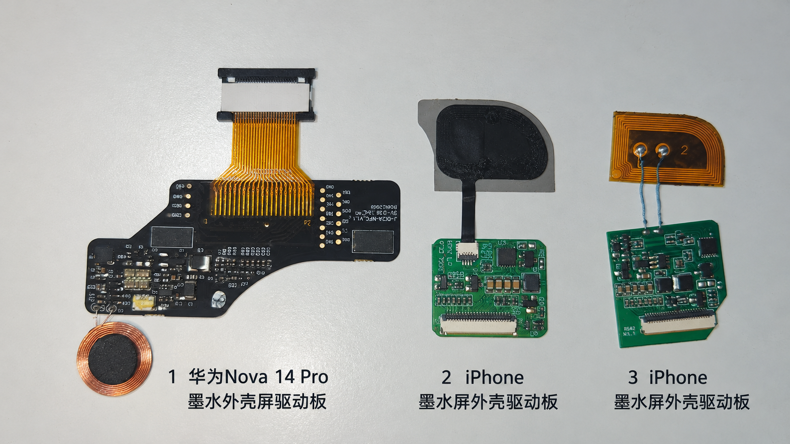
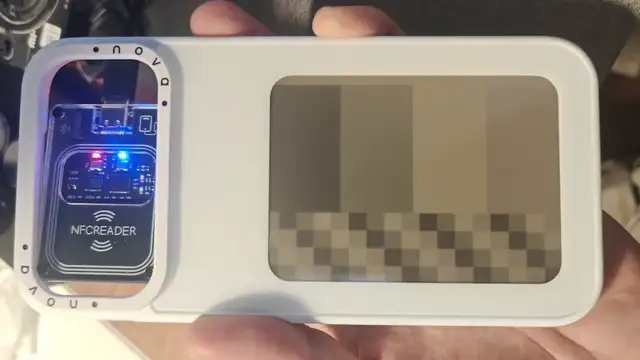

# Ink NFC FMSC by PN532

[中文](README.md) | [English](README.en.md)

## 项目介绍

本工具支持**墨有引力华为Nova彩显手机壳NFC驱动板**，以及其他采用兼容协议的 **FMSC 无源墨水屏 NFC 驱动板**（如 iPhone 等墨水屏手机壳）。通过 PN532 或 PCR532 串口读写器，可选择屏幕驱动、处理图片，并进行传图刷新、清白和重刷。

支持 Windows、macOS 和 Linux，要求 Python 3.11 或更新版本。

## 使用限制

**NFC 供电能力可能不足，导致分辨率较大的屏幕无法完成刷新。** 读写器、天线位置、线圈匹配、驱动板储能和屏幕负载共同影响结果。绝大部分情况下都能找到驱动板并完成图片传输，但不代表供电能够持续支持墨水屏刷新。延长等待时间、压缩图片或分段刷新也不保证解决供电问题。

**此前使用 PN532 和小线圈测试华为 A0、A1 屏幕时，刷新启动后多次失联，未能稳定完成刷新。** 使用 PCR532、Nova 15 Pro/Ultra 手机壳及藏在摄像头边框内的原配大线圈，现已使用板内原厂驱动完成 A1 屏幕刷新；改写为本工具的 A1 驱动配方后，返回 `68CA`，未完成刷新。该结果不代表自定义 A1 驱动已验证通过，也不代表 PN532 或其他线圈组合均可驱动 A0/A1；单独出现 `RF_TIMEOUT` 不能直接证明芯片掉电。

> [!CAUTION]
> **更换屏幕并写入对应驱动配置，会覆盖驱动板原厂的屏幕配置和驱动流程，当前工具无法还原，原厂信息可能无法找回。** 传图或清白时指定 `--screen` 或自定义配方，且未添加 `--use-stored-driver`，即会写入所选配置；请在操作前确认能够接受这一风险。

驱动板还受图片存储容量限制，压缩不会增加解压后的存储空间。A0/A1 的分段刷新属于实验功能，不保证另一段画面保持不变。屏幕型号不能自动识别，必须确认主控、分辨率、颜色和接线。列入屏幕目录不代表所有读写器、驱动板和屏幕组合均可完成刷新。

## 实测范围

使用 **PCR532** 读写器，以下驱动板与已测试屏幕的组合能够完成刷新：

| 驱动板 | 已实测可驱动的屏幕范围 |
|---|---|
| 华为Nova墨水屏手机壳NFC驱动板 | 400×300 分辨率及以下的已测试屏幕 |
| 华为 Nova 15 Pro/Ultra 原配手机壳驱动板及摄像头边框线圈 | 原配 A1 552×768 四色屏，仅保留板内原厂驱动时刷新成功；本工具 A1 配方返回 `68CA` |
| FMSC墨水屏NFC驱动板（iPhone 墨水屏外壳） | 2.13 英寸及以下的已测试屏幕 |



照片从左到右：华为Nova 14 Pro 墨水外壳屏驱动板，以及两种 iPhone 墨水屏外壳驱动板。

以上为当前读写器、驱动板、线圈和屏幕组合的实测结果，不是所有同尺寸、同分辨率型号的兼容性保证。Nova 15 Pro/Ultra 原厂驱动与本工具 A1 配方的行为存在差异，原因仍在排查；不能将该成功案例视为本工具 A1 配方的验证结果。屏幕面积、颜色、驱动波形及供电条件同样影响结果。

### 刷新演示

PCR532 刷新华为 Nova 15 Pro/Ultra 墨水屏手机壳（A1，552×768 四色）。线圈藏在摄像头边框内。**视频中的成功刷新使用板内原厂驱动，不是本工具写入的 A1 配方；后者在当前组合中返回 `68CA`。**

[](https://github.com/solar2ain/ink-nfc-fmsc-by-pn532/raw/refs/heads/main/assets/demos/nova15-pro-ultra-a1-pcr532.mp4)

[下载完整横向视频（MP4，约 2.3 MB）](https://github.com/solar2ain/ink-nfc-fmsc-by-pn532/raw/refs/heads/main/assets/demos/nova15-pro-ultra-a1-pcr532.mp4)

复现视频中的原厂驱动刷新方式（将 `COMxx` 替换为实际串口）：

```sh
python -m ink_nfc_fmsc send-test --screen huawei-a1 --use-stored-driver --port COMxx
```

> [!CAUTION]
> **必须带上完整参数 `--use-stored-driver`，不要省略。** 不带此参数会覆盖原厂 DA/DB 配置，无法恢复；当前自定义 A1 配方实测返回 `68CA`。此参数仅保留板内当前驱动，不能恢复已被覆盖的原厂驱动。

使用华为驱动板刷新 Osptek 1.54 英寸 E6 墨水屏。

https://github.com/user-attachments/assets/fd2017f3-80f8-404b-bc5e-848eb191e1c7

## 安装与连接

```sh
python -m pip install .
```

也可使用 `python -m pip install 安装包.whl` 安装。建议使用独立的 Python 虚拟环境。下文采用 `python -m ink_nfc_fmsc`，安装后也可使用 `ink-nfc-fmsc` 或 `ink-nfc`。

连接读写器并接好屏幕，将驱动板线圈固定在读写器感应区。刷新期间不要移动线圈或拔插屏幕排线。这里只支持兼容 PN532 协议的 UART 串口接口，不支持 PC/SC 读卡器、SPI 或 I2C 直连。

```sh
python -m ink_nfc_fmsc ports
python -m ink_nfc_fmsc probe --port COMxx
```

Windows 串口名称为 `COM` 加端口号，例如 `COM3`。本文命令中的 `COMxx` 是占位符，执行时必须替换为 `ports` 输出的实际串口名称。macOS 通常使用 `/dev/cu.usbserial-...`，Linux 通常使用 `/dev/ttyUSB0` 或 `/dev/ttyACM0`。Linux 用户需要串口访问权限。

## 选择屏幕

```sh
python -m ink_nfc_fmsc screens
python -m ink_nfc_fmsc screens --ic SSD1683
```

屏幕统一命名为 **主控-分辨率-颜色**，大小写不敏感。仅华为 A0/A1 使用变体后缀。列表包含屏幕、别名和状态三列；没有别名时留空，暂不可用的屏幕不列出。

别名仅保留 `huawei-a0`、`huawei-a1`、`osptek-e6-154`、`osptek-e6-169`、`osptek-e6-370`；其他屏幕请使用完整规范名称。

| 屏幕 | 型号参数 |
|---|---|
| SSD1683 黑白红 | `SSD1683-400x300-BWR` |
| 华为 A0 | `JD79665AA-552x768-BWRY-A0`，别名 `huawei-a0` |
| 华为 A1 | `JD79665AA-552x768-BWRY-A1`，别名 `huawei-a1` |
| SSD1675 黑白 | `SSD1675-152x152-BW` |
| SSD1619 黑白红 | `SSD1619-128x250-BWR` |
| JD79668AA 四色 | `JD79668AA-400x300-BWRY` |
| Osptek 1.54 E6 | `IST7513-240x240-E6`，别名 `osptek-e6-154` |

颜色代码为 `BW`（黑白）、`BWR`（黑白红）、`BWRY`（黑白黄红）、`GRAY4`（四级灰度）、`E6`（六色）。不能仅修改分辨率来适配未知屏幕。

## 传图、清白和重刷

```sh
python -m ink_nfc_fmsc send assets/examples/mountain-journey-400x300.png --screen SSD1683-400x300-BWR --port COMxx
python -m ink_nfc_fmsc send-test --screen SSD1683-400x300-BWR --port COMxx
python -m ink_nfc_fmsc send-color red --screen SSD1683-400x300-BWR --port COMxx
python -m ink_nfc_fmsc clear --screen SSD1683-400x300-BWR --port COMxx
python -m ink_nfc_fmsc refresh --screen SSD1683-400x300-BWR --port COMxx
```

`send` 传图后刷新；`send-test` 根据屏幕分辨率和颜色生成色块与底部棋盘格测试图，传图后刷新，无需图片文件；`send-color` 将屏幕刷为指定单色，无需图片文件；`clear` 写入全白图片后刷新，不是恢复出厂；`refresh` 仅重刷驱动板已经保存的图片，不传新图片或改写驱动。`send-test`、`send-color` 与 `send` 使用相同的配置确认、压缩传输和分段刷新规则。

`send-color` 的颜色名称不区分大小写，与用于筛选屏幕类型的 `--color BWR` 等参数不同。单色直接使用屏幕原生色码，不经过抖动或照片处理；不支持的颜色会在写入前报错。`send-color white` 与 `clear` 的全白数据相同。

| 颜色名称 | 全屏颜色 | 支持的屏幕颜色类型 |
|---|---|---|
| `black`、`white` | 黑、白 | 全部 |
| `red` | 红 | BWR、BWRY、E6 |
| `yellow` | 黄 | BWRY、E6 |
| `green`、`blue` | 绿、蓝 | E6 |
| `dark-gray`、`light-gray` | 深灰、浅灰 | GRAY4 |

测试图默认采用横屏布局，竖屏型号也按横屏观看方向排版，再自动旋转为屏幕原生像素格式；不会改变驱动配置中的分辨率。

### 使用板内原厂驱动

从 0.1.20 起，添加 `--use-stored-driver` 可明确选择图像格式，同时保留驱动板当前保存的驱动。以下 A1 命令不写 DA/DB，使用 D3 传图并由 D4 执行板内流程；状态查询默认 9 Hz：

```sh
python -m ink_nfc_fmsc send-test --screen huawei-a1 --use-stored-driver --port COMxx
python -m ink_nfc_fmsc send picture.png --screen huawei-a1 --use-stored-driver --port COMxx
python -m ink_nfc_fmsc clear --screen huawei-a1 --use-stored-driver --port COMxx
```

`--screen` 在此模式下只选择分辨率、颜色和像素编码，不安装该屏幕的驱动配方；仍会检查板内配置是否匹配。A0 可将屏幕名称替换为 `huawei-a0`，但不代表已实测成功。读写器默认自动兼容 PN532/PCR532。

> [!IMPORTANT]
> **此选项保留的是当前驱动，不会恢复原厂驱动，也不能判断它是否仍为原厂版本。** 使用原厂流程的前提是驱动板尚未被改写。若此前已覆盖 DA/DB，添加此参数仍会使用覆盖后的驱动。保留驱动模式不能与分段刷新同时使用；存储容量不足时将停止，不自动改写配置。

> [!CAUTION]
> 传图或清白时指定 `--screen`（或自定义配方）且未添加 `--use-stored-driver`，将覆盖驱动板的原厂屏幕配置，当前工具无法还原原厂驱动。执行前会显示风险确认，请核对屏幕型号和接线。

默认执行前要求手动确认。自动化运行时可添加 `--yes` 跳过确认；它不会降低风险，也不是 PIN 或压缩开关。

不指定 `--screen` 或自定义配方时，传图和清白保留已存驱动，不写 DB/DA。实际连接的屏幕必须与板内配置一致。程序先读取配置；若无法唯一确定图像格式，将停止，可用 `--ic`、`--resolution`、`--color` 缩小范围。D1 无法区分某些同尺寸型号及 A0/A1，不能据此自动判断实体屏幕。

```sh
python -m ink_nfc_fmsc send picture.png --port COMxx --ic SSD1683
python -m ink_nfc_fmsc clear --port COMxx --ic SSD1683
```

默认使用 D3 + LZO 压缩传图；添加 `--no-compress` 使用 D2 原始传输。读写器默认自动兼容 PN532/PCR532，无需指定型号。

驱动板默认自动寻卡。华为Nova墨水屏手机壳NFC驱动板采用特殊唤醒，必要时自动验证一次已知 PIN；标准唤醒的 FMSC墨水屏NFC驱动板不发送 PIN。需要限制类型时才指定 `--board huawei` 或兼容参数 `--board iphone`。

## 调整与预览图片

```sh
python -m ink_nfc_fmsc prepare picture.png --screen SSD1683-400x300-BWR --output output/preview
python -m ink_nfc_fmsc algorithms
```

`prepare` 只生成电脑上的预览，不连接读写器。

| 参数 | 用途 |
|---|---|
| `--rotation 90` | 顺时针旋转；还可选 0、180、270 |
| `--fit stretch` | 拉伸铺满；默认居中裁剪 |
| `--algorithm atkinson` | 选择抖动算法 |
| `--preset vivid` | 选择鲜艳预设；默认均衡 |
| `--contrast 1.2` | 调整对比度 |
| `--mirror-x` | 左右镜像 |

更多设置参见[进阶使用](docs/advanced-use.md)。测试图片说明见 [assets](assets/README.md)。

## 状态与故障

终端日志包含时间、阶段和等级：`INFO` 蓝色、`SUCCESS` 绿色、`WARN` 黄色、`ERROR` 红色。文件日志为纯文本；重定向输出或设置 `NO_COLOR=1` 时不使用颜色。

| 返回值 | 含义 |
|---|---|
| `SW=9000` | 当前命令被接受 |
| `DE=01` / `DE=00` | 驱动板报告忙 / 空闲 |
| `68CA` / `698A` | 驱动板报告低电压 |
| `68CB` | 驱动板报告刷新超时 |
| `RF_TIMEOUT` | 未收到有效回包，不能仅据此认定掉电 |
| `6985` | 使用条件未满足，可能需要认证 |
| `6451` | 配置相关错误；应核对屏幕配方及详细日志 |

失败后程序停止，不自动重复认证、写入或刷新。按 Ctrl+C 可取消，程序会尝试关闭射频场并释放串口。刷新等待期间不主动关闭射频场。

已观察到忙状态后，连续收到 3 次 `DE=00` 即结束等待，不再等待固定最短时长；若始终未观察到忙状态，仍保留最低观察时间并提示无法确认。**驱动板报告空闲仍需确认画面是否完整。**

每次操作生成 `run.log`、`summary.json`，传图（包括 `send-test`、`send-color`）时另有 `preview.png`。反馈问题时请提供日志目录和实际屏幕表现。

六色屏必须独立处理第 16 脚，不能默认将第 15、16 脚同时接到 3.3V；核对接线后才添加 `--confirm-e6-wiring`。

[故障排查](docs/troubleshooting.md) · [协议与兼容性](docs/protocol.md) · [组件与许可](docs/sources.md)


## 免责声明

本工具按“现状”提供，不保证适用于任何特定设备或用途。

> [!CAUTION]
> **更换屏幕并写入对应配置，会覆盖驱动板的原厂屏幕配置和驱动流程，当前工具无法还原，相关原厂数据可能永久丢失。** 请谨慎操作，并在执行前确认屏幕型号、接线及供电条件；不能接受上述风险时，请勿继续。

使用本工具及自行改装硬件的风险由使用者承担。在适用法律允许的范围内，项目作者及贡献者不对因使用本工具造成的数据丢失、设备损坏、刷新失败或其他损失承担责任。

## Licence

代码采用 [GNU GPLv3 或更新版本](LICENSE)。第三方组件和测试图片适用各自的许可条件。
